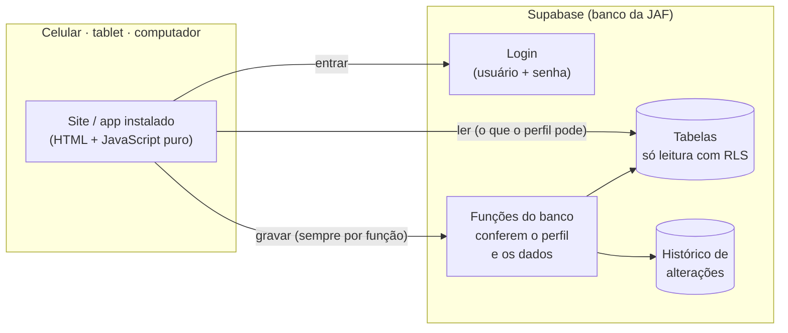

<div align="center">


# JAF Metal · Gestão

**O almoxarifado, as compras, a fábrica e o dinheiro da JAF Metal num só lugar — no computador, no tablet e no celular.**

[](https://github.com/Enzoo-August/JAF-METAL/actions/workflows/testes.yml)
[](https://github.com/Enzoo-August/JAF-METAL/security/code-scanning)


</div>

---

## O que é

Um sistema web, instalável como aplicativo, que **substitui a planilha do almoxarifado** da JAF Metal e vai além dela. Tudo o que a planilha fazia continua aqui — cadastro de peças e fornecedores, entradas e saídas, controle de pedidos, lista de compras, consumo anual e análise de custos — só que com login por pessoa, regras de segurança no banco de dados, histórico de quem fez o quê e telas pensadas para o dia a dia da fábrica.

> **Os dados ficam só no banco de dados (Supabase).** Este repositório guarda apenas o código: nenhuma planilha, nenhum dado de cliente, fornecedor ou funcionário, nenhuma senha.

## O que o sistema faz

| Área | No dia a dia |
|---|---|
| 🧰 **Estoque** | Retirar peça em 3 toques (quem retirou, para qual máquina) · dar entrada · contar estoque (inventário) · situação de cada peça: *Comprar*, *No mínimo*, *Estoque alto* · ficha com consumo dos últimos 12 meses, quanto tempo o estoque dura e a evolução do preço |
| 🛒 **Compras** | Lista de compras automática (abaixo do mínimo, sugerindo até o máximo e descontando o que já está a caminho) · pedido de compra com PDF, WhatsApp e e-mail para o fornecedor · recebimento total ou parcial · pedidos atrasados em destaque |
| 🚚 **Fornecedores** | Cadastro completo (CNPJ e CEP preenchem sozinhos) · qualificação com validade · total comprado por ano · **pontualidade de entrega** de cada um |
| ⚙️ **Máquinas** | Situação de cada máquina · chamado de "máquina com problema" · preventiva com prazo e aviso · custo de peças e serviços por máquina · horas paradas |
| 🏭 **Produção** | Ordens de produção em quadro (*Na fila → Produzindo → Pronta → Entregue*) · apontamento de quantidade · prioridade e prazo · entrega já lança a conta a receber |
| 💰 **Financeiro** | Contas a pagar e a receber com parcelas · baixa com juros/desconto · **fluxo de caixa** com saldo projetado para 7, 30 e 90 dias · receitas e despesas por categoria |
| 👥 **Equipe** | Funcionários, salários e dados pessoais (só para quem pode ver) · controle de férias pela CLT · peças retiradas por pessoa |
| 📊 **Relatórios** | Os mesmos da planilha (estoque, consumo anual, análise de custos) e novos: *dinheiro parado*, custo por máquina, pontualidade de fornecedor — tudo exporta para Excel e PDF |
| 🛡️ **Administração** | Acessos por pessoa · histórico de alterações · cópia de segurança completa em Excel (no mesmo formato da planilha antiga) · importação da planilha |

### Quem vê o quê

| Perfil | Acesso |
|---|---|
| **Dono** | Tudo, inclusive acessos, importação e histórico de alterações |
| **Escritório** | Tudo do dia a dia (financeiro, salários, compras, estoque, produção); não cria acessos |
| **Almoxarifado** | Estoque, compras, fornecedores, máquinas e ordens; **sem** financeiro e salários |
| **Produção** | Retirar peça, ver estoque **sem preços**, ordens de produção e chamados de máquina |

Essas regras estão **dentro do banco de dados** (Row Level Security + funções que conferem o perfil): não dependem do aparelho nem do navegador.

## Como funciona



**Regras que o sistema segue**

- **Estoque = soma das movimentações.** Nenhuma movimentação é apagada ou editada: para corrigir, existe o **Desfazer**, que lança a contrária e fica registrado.
- **PEPS (o que entra primeiro sai primeiro):** cada nota é um lote com o preço pago; a retirada sai do lote mais antigo e usa o preço dele — automático, como a planilha fazia à mão.
- **Comprar** = estoque abaixo do mínimo (a mesma regra da planilha).
- **Nada é lançado em dobro:** cada envio tem um identificador; toque duplo ou internet que cai no meio não repetem a operação.
- **Sem internet, nada fica "esperando escondido":** o sistema avisa na hora que não salvou.
- Datas "de hoje" no fuso de São Paulo.

## Segurança

- Toda gravação passa por uma função do banco que confere **quem** está fazendo e **se pode**; as tabelas não aceitam gravação direta.
- Cadastro aberto bloqueado: conta só nasce pelo próprio sistema, criada pelo Dono.
- Senha criada pelo Dono é **provisória**: a pessoa cria a própria no primeiro acesso (mínimo 8 caracteres, senhas fáceis recusadas).
- Produção não vê preços nem dados de fornecedores; salários e financeiro só para Dono e Escritório.
- Histórico de alterações com quem, quando e o que mudou.
- A chave que aparece em `js/config.js` é a **publishable** (pública por natureza); a chave secreta nunca entra no código.

## Qualidade

A cada envio para este repositório, o GitHub roda sozinho ([Actions](https://github.com/Enzoo-August/JAF-METAL/actions)):

| Verificação | O que confere |
|---|---|
| **Banco** — 134 conferências | Perfis e permissões, estoque e PEPS, desfazer, pedidos de compra (parcial, total, cancelado), financeiro (parcelas, baixas), produção, importação, senha provisória, cadastro bloqueado |
| **Telas** — 105 conferências × 2 tamanhos | O sistema usado como uma pessoa usaria: abre janelas, digita, escolhe, toca nos botões — inclusive toque duplo e troca de usuário |
| **Layout** — 4 tamanhos × 4 perfis | Nenhum botão cortado, coberto ou fora da tela; nada de rolagem para o lado (celular, tablet e computador) |
| **Repositório** | Nenhuma planilha e nenhuma chave secreta no código |
| **CodeQL** | Análise de segurança do código pelo GitHub |

A importação da planilha real também tem teste próprio (`testes/importacao-real.mjs`), que roda só no computador — a planilha nunca vem para cá. Ele confere peça por peça que o estoque do sistema é igual ao da planilha.

## Rodar no computador

O sistema não precisa de instalação nem de "build": é só servir a pasta.

```bash
python -m http.server 8000
```

- `http://localhost:8000` — sistema real (pede login).
- `http://localhost:8000/?modo=teste&banco=memoria` — **modo teste**: um Postgres de verdade roda dentro do navegador (PGlite) com o mesmo `schema.sql` e dados de exemplo. Só funciona em `localhost`; no endereço publicado é impossível abrir. Logins: `dono`, `escritorio`, `almox`, `operador` — senha `teste1234`.

Testes no computador:

```bash
PGLITE=<pasta com @electric-sql/pglite instalado> node testes/banco.mjs
PLAYWRIGHT_DIR=<pasta com playwright> URL=http://localhost:8000 node testes/ui-ci.mjs
```

## Estrutura

```
index.html · manifest.webmanifest · sw.js   o app (instalável, abre sem internet para consulta)
css/app.css                                  visual (claro/escuro, celular/tablet/computador)
js/                                          núcleo: dados, telas, PDF, importação da planilha
js/telas/                                    uma tela por arquivo (estoque, compras, produção…)
supabase/schema.sql                          o banco inteiro: tabelas, segurança e funções
testes/                                      testes automáticos (banco, telas, layout)
docs/LEIAME.md                               anotações técnicas
publicar.sh                                  monta a pasta de publicação (sem testes nem modo teste)
```

## Situação

- ✅ Banco da JAF criado e conferido (idêntico à versão testada).
- ✅ Dados da planilha do almoxarifado importados e conferidos peça por peça.
- ✅ Logins dos donos criados com senha provisória.
- ⏳ **Publicação do endereço** — aguardando a conferência passo a passo.

### Próximas ideias

- Pedido de compra da Upgrade chegar direto como ordem de produção na JAF.
- Etiquetas com QR code nas prateleiras: apontar a câmera abre a retirada da peça.
- Cópia de segurança automática diária.

---

<div align="center">
<sub>JAF Metal · Gestão — feito sob medida para a JAF Metal.</sub>
</div>
